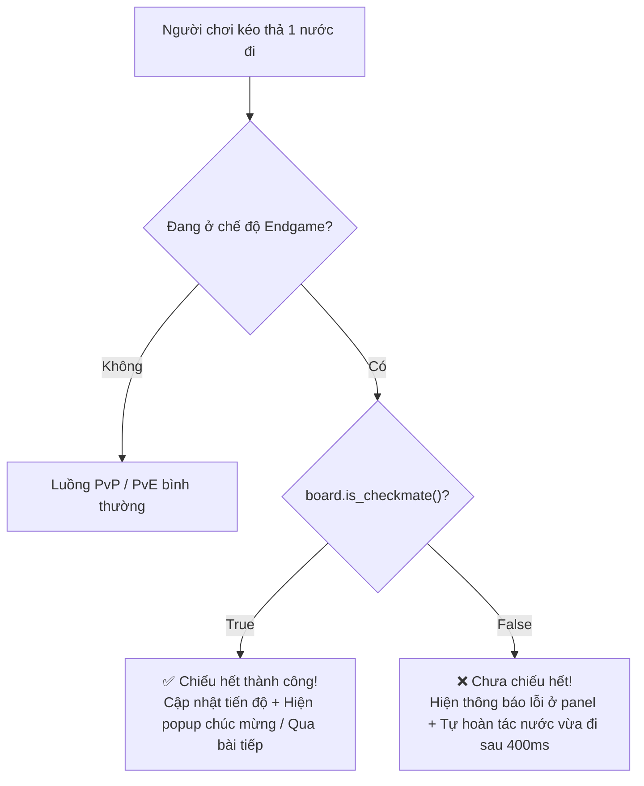

# Kế Hoạch Thêm Chế Độ: Thế Cờ Tàn (Chiếu Hết Trong 1 Nước)

## 1. Mục Tiêu Tính Năng
- Bổ sung chế độ chơi thứ 3 bên cạnh **PvP** và **PvE**: **🧩 Thế cờ tàn (Mate in 1)**.
- Phân chia các cấp độ từ thấp đến cao (Cấp 1 $\rightarrow$ Cấp 4).
- Người chơi **bắt buộc phải chiếu hết (Checkmate) chỉ trong đúng 1 nước đi**:
  - **Đi đúng (Checkmate):** Ghi nhận hoàn thành, mở khóa/chuyển sang thế cờ tiếp theo.
  - **Đi sai (Chưa chiếu hết):** Thông báo chưa chính xác và tự động trả lại vị trí ban đầu để thử lại.
- Hỗ trợ nút **💡 Gợi ý (Hint)** và **⏭ Chuyển bài**.

---

## 2. Phân Cấp Độ Thế Cờ Tàn

| Cấp độ | Tên gọi | Dạng thế cờ đặc trưng | Số bài dự kiến |
| :---: | :--- | :--- | :---: |
| 1 | 🟢 Cơ bản | Chiếu hết bằng Hậu, 2 Xe, hoặc Hậu + Vua (Back-rank mate, Kiss of Death) | 5 bài |
| 2 | 🟡 Trung cấp | Phối hợp 2 quân (Xe + Tượng, Hậu + Mã, Xe + Tốt) | 5 bài |
| 3 | 🟠 Nâng cao | Phong cấp thành Hậu/Mã để chiếu hết, đòn chiếu bí thắt cổ (Smothered Mate), ghim quân | 5 bài |
| 4 | 🔴 Cao thủ | Thế cờ tàn nhiều quân cản, tìm nước chiếu hết ẩn (Arabian Mate, Anastasia's Mate, Epaulette Mate) | 5 bài |

---

## 3. Cấu Trúc File Thay Đổi & Bổ Sung

```
src/
├── core/
│   ├── constants.py      # [CẬP NHẬT] Thêm GameMode.ENDGAME và EndgameLevel
│   ├── puzzles.py        # [MỚI] Kho thế cờ tàn (FEN, cấp độ, tên đòn, gợi ý)
│   └── game_state.py     # [CẬP NHẬT] Lưu trạng thái bài giải hiện tại, tiến độ
└── ui/
    ├── board_widget.py   # [CẬP NHẬT] Thêm load_fen(fen, flip) & highlight gợi ý
    ├── game_menu.py      # [CẬP NHẬT] Thêm chọn mode Thế cờ tàn + chọn cấp độ
    ├── info_panel.py     # [CẬP NHẬT] Hiện tên thế cờ, tiến độ, nút Gợi ý / Thử lại / Tiếp theo
    └── main_window.py    # [CẬP NHẬT] Logic kiểm tra is_checkmate() sau 1 nước & auto-revert
tests/
└── test_puzzles.py       # [MỚI] Kiểm chứng mọi FEN trong puzzles.py đều có ít nhất 1 nước Mate-in-1
```

---

## 4. Chi Tiết Thiết Kế Từng Phần

### 4.1. `src/core/constants.py` & `src/core/puzzles.py`
- Trong `GameMode`: thêm `ENDGAME = "endgame"`.
- Trong `EndgameLevel`: định nghĩa 4 cấp độ (`1..4`) kèm nhãn hiển thị.
- Trong `puzzles.py`: định nghĩa dataclass `EndgamePuzzle`:
  ```python
  @dataclass(frozen=True)
  class EndgamePuzzle:
      id: str
      level: int
      title: str
      fen: str
      hint: str
  ```
- **Lưu ý kỹ thuật:** Không cần hardcode đáp án cứng nhắc vì `python-chess` kiểm tra trực tiếp `board.is_checkmate()`. Nếu một thế cờ có 2 nước đều chiếu hết được thì cả 2 đều được tính hợp lệ.

### 4.2. `src/core/game_state.py`
- Bổ sung:
  - `endgame_level: int`
  - `puzzle_index: int`
  - `solved_ids: set[str]`
  - Property `is_endgame`

### 4.3. `src/ui/board_widget.py`
- Thêm `load_fen(fen: str, flip: bool = False) -> None`:
  - Nạp thế cờ bằng `self.board.set_fen(fen)`.
  - Reset `_selected`, `_legal_dsts`, `_last_move`, cập nhật `_flip` (tự động xoay bàn cờ về phía người đi trước nếu bên Đen đi trước).
- Thêm `show_hint(square: chess.Square) -> None`:
  - Highlight ô quân cờ cần di chuyển để gợi ý cho người chơi.

### 4.4. `src/ui/game_menu.py` & `src/ui/info_panel.py`
- **`GameMenuDialog`:**
  - Radio button thứ 3: `🧩 Thế cờ tàn (Chiếu hết 1 nước)`.
  - Khi chọn mode này, ẩn phần chọn phe & AI level, hiện ComboBox chọn **Cấp độ cờ tàn (1–4)**.
- **`InfoPanel`:**
  - Thêm `set_endgame_mode(level_name, puzzle_title, current, total)`
  - Hiện nút **💡 Gợi ý** và **⏭ Bài tiếp theo** (ẩn nút Undo/Resign khi ở chế độ cờ tàn hoặc giữ nút Chơi lại bài).

### 4.5. `src/ui/main_window.py` — Luồng Xử Lý Nước Đi


---

## 5. Kiểm Thử (`tests/test_puzzles.py`)
- Tự động duyệt toàn bộ danh sách `EndgamePuzzle` trong `puzzles.py`:
  1. Kiểm tra `chess.Board(puzzle.fen).is_valid()` hợp lệ.
  2. Kiểm tra ván cờ chưa kết thúc trước khi đi (`not board.is_game_over()`).
  3. Kiểm tra tồn tại ít nhất 1 nước đi trong `board.legal_moves` mà sau khi `push(move)` cho kết quả `board.is_checkmate() == True`.
