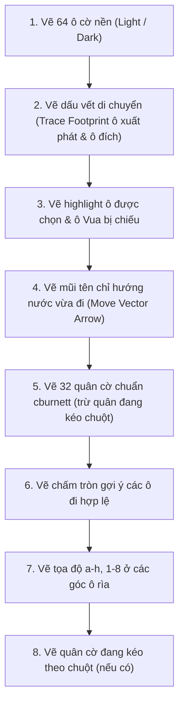

# Kế Hoạch Nâng Cấp Giao Diện Cờ Vua Chuẩn Quốc Tế & Dấu Vết Di Chuyển

Tài liệu này đặc tả chi tiết kế hoạch và giải pháp kỹ thuật nâng cấp giao diện bàn cờ đạt chuẩn các nền tảng quốc tế hàng đầu (**Lichess**, **Chess.com**, **FIDE Online Arena**).

---

## 1. Hiện Trạng & Điểm Cần Cải Thiện

| Thành phần | Hiện tại | Chuẩn Quốc Tế (Đề xuất) |
| :--- | :--- | :--- |
| **Bộ quân cờ** | Vector vẽ thô sơ, nét vẽ chưa đều, mắt Mã và mũ Tượng chưa đúng chuẩn FIDE. | **Bộ `cburnett` (Lichess/Wikimedia standard)**: Bộ quân chuẩn vàng thế giới với đường cong bezier mượt mà, tỷ lệ vàng, đổ bóng viền sắc nét trên mọi độ phân giải. |
| **Dấu vết di chuyển** | Chỉ đổi màu vàng nhạt cả 2 ô, khó nhận biết hướng đi vừa xảy ra từ ô nào sang ô nào. | **Dấu vết đa tầng (Multi-layer Move Trace)**:<br>1. Highlight 2 ô với màu vàng chanh hiện đại.<br>2. Ô xuất phát có viền bo mờ đánh dấu "vết chân" vừa dời đi.<br>3. **Mũi tên vector bán trong suốt** chỉ từ ô cũ đến ô mới. |
| **Tọa độ bàn cờ** | Ký tự `a-h`, `1-8` vẽ lơ lửng viền ngoài. | Vẽ trực tiếp vào góc trong của ô rìa bàn cờ (phong cách Chess.com/Lichess), tự đổi màu tương phản với ô sáng/tối. |
| **Bảng màu ô cờ** | Nâu gỗ cổ điển đơn điệu. | Chuẩn **Lichess Wood** hoặc **Tournament Green** dịu mắt, tăng độ tập trung. |

---

## 2. Chi Tiết Các Hạng Mục Nâng Cấp

### 2.1. Bộ quân cờ Vector chuẩn quốc tế (`cburnett`)
- **Tác giả:** Colin M.L. Burnett (tiêu chuẩn được dùng chính thức trên Lichess và Wikipedia Cờ vua).
- **Đặc trưng:**
  - **Vua (King):** Thánh giá cân đối, đường cong mũ vương quyền uy nghi.
  - **Hậu (Queen):** Vương miện 5 đỉnh đính 5 hạt ngọc tròn đều tuyệt đối.
  - **Xe (Rook):** 3 răng thành chuẩn mực, khối đế vững chãi.
  - **Tượng (Bishop):** Vết xẻ mũ giáo hoàng sâu và sắc nét, đỉnh chóp ngọc tròn.
  - **Mã (Knight):** Bờm ngựa có nếp gấp chi tiết, cơ hàm và mắt biểu cảm tinh tế.
  - **Tốt (Pawn):** Đầu tròn đều đặn, thân hình thon gọn cân đối.
- **Màu sắc & Độ tương phản:**
  - Quân Trắng: Nền ngọc sáng `#FFFFFF`, viền mực mảnh `#000000` (độ dày 1.5px).
  - Quân Đen: Nền mun `#1E1E1E` (hoặc `#262421`), viền sáng nhẹ giúp nổi bật rõ ràng ngay cả khi đứng trên ô màu tối.

---

### 2.2. Dấu vết di chuyển (Move Trace Indicator)
Khi một quân cờ di chuyển (do người chơi hoặc AI):
1. **Ô xuất phát (Origin Square):**
   - Phủ màu highlight vàng nhạt: `rgba(255, 235, 59, 0.45)`.
   - Vẽ một vòng tròn định vị "vết chân" mờ ở tâm ô, báo hiệu quân cờ vừa rời khỏi đây.
2. **Ô đích đến (Destination Square):**
   - Phủ màu highlight vàng đậm hơn: `rgba(205, 220, 57, 0.65)`.
   - Quân cờ đứng trên ô đích sẽ nổi bật rõ ràng.
3. **Mũi tên vector chỉ hướng đi (Move Arrow):**
   - Vẽ một mũi tên vector mềm mại từ tâm ô xuất phát đến tâm ô đích đến (màu vàng cam hổ phách `rgba(255, 170, 0, 0.75)` hoặc xanh ngọc dịu `rgba(76, 175, 80, 0.75)`).
   - Đầu mũi tên dạng tam giác vát cạnh theo chuẩn truyền hình trực tiếp cờ vua quốc tế (Broadcast Chess).

---

### 2.3. Tọa độ bàn cờ tích hợp (In-board Coordinates)
- Chữ số hàng `1` - `8` nằm ở góc trên-trái của cột ngoài cùng (cột `a` hoặc `h` tùy góc nhìn).
- Chữ cái cột `a` - `h` nằm ở góc dưới-phải của hàng ngoài cùng (hàng `1` hoặc `8`).
- Màu chữ tự động đảo ngược: Ô tối dùng chữ màu sáng, ô sáng dùng chữ màu tối, font chữ sans-serif tinh tế (Roboto / Segoe UI / Arial).

---

## 3. Kiến Trúc File Sẽ Can Thiệp

```
src/ui/
├── piece_svg.py       # CẬP NHẬT: Thay thế toàn bộ 12 chuỗi SVG bằng bộ cburnett chuẩn Lichess
├── board_widget.py    # CẬP NHẬT: 
│                       - Bổ sung hàm _draw_trace_footprint() (vẽ dấu vết ô đi)
│                       - Bổ sung hàm _draw_move_arrow() (vẽ mũi tên vector chỉ hướng)
│                       - Tinh chỉnh màu sắc bảng cờ và tọa độ lồng trong ô
```

---

## 4. Minh Họa Quy Trình Vẽ Bàn Cờ Mới (Trong `paintEvent`)



---

## 5. Các Tùy Chọn Đề Xuất

1. **Kiểu dấu vết:**
   - **Lựa chọn A (Khuyên dùng):** Highlight 2 ô màu vàng chanh hiện đại + 1 mũi tên vector chỉ đường từ ô cũ sang ô mới (phong cách Chess.com/Lichess).
   - **Lựa chọn B:** Chỉ highlight 2 ô + vòng tròn dấu vết ở ô xuất phát (không vẽ mũi tên).
2. **Bộ màu bàn cờ:**
   - **Classic Wood:** Gỗ sồi sáng `#F0D9B5` & Gỗ óc chó `#B58863`.
   - **Tournament Green:** Trắng ngà `#EEEED2` & Xanh lá thi đấu FIDE `#769656`.
